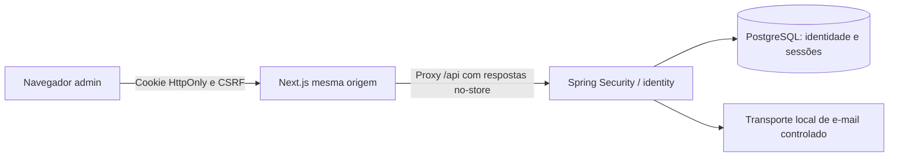

# SC-002 — Identidade e autenticação: plano para aprovação

Data: 2026-10-15. Estado: **PROPOSTO; não implementar sem aprovação humana**.

Fonte: PRD, Sprint 1, BUSINESS_RULES, ARCHITECTURE e ADR-0004. Decisão proposta detalhada no [ADR-0005](../architecture/adr/0005-identity-authentication.md); análise independente de [segurança](../security/SC-002-THREAT-MODEL.md) e [QA](../quality/SC-002-TEST-PLAN.md).

## Resultado esperado e limites

O lojista poderá cadastrar sua identidade, entrar, consultar a própria identidade, sair e recuperar acesso. O backend protege endpoints e credenciais. Cadastro não cria empresa/loja, não concede OWNER e não implementa membership: essas responsabilidades continuam na SC-003. Cadastro público não cria administrador da plataforma. Convites de funcionários, login de compradores, MFA, login social e SSO não entram nesta entrega.

Recuperação e telas administrativas mínimas são propostas deste plano, sujeitas à aprovação; a Sprint 1 define cadastro/login e não detalha esses fluxos. Não antecipar todo DATA_MODEL nem criar serviços de negócio sem uso.

## Comparação e recomendação

Spring Security é o framework Java de autenticação/autorização para todas as opções. A escolha real é onde manter credenciais e o ciclo de conta, e como estabelecer sessão.

| Opção | Cadastro, login e recuperação | Sessão e permissões | Custo e operação | Evolução |
| --- | --- | --- | --- | --- |
| Spring Security + credenciais locais | Equipe mantém fluxos com componentes do framework, transporte de e-mail e controles de abuso | Sessão opaca JDBC revogável; autorização de empresa continua local | Sem novo serviço; maior responsabilidade de engenharia e segurança | OIDC pode ser integrado depois com vínculo explícito de contas |
| Keycloak/OIDC + Spring Security | IdP centraliza credenciais, login, recuperação e políticas; configuração e e-mail continuam necessários | Sessão do IdP distinta da sessão local; roles/claims não dispensam validar membership local | Licença aberta; mais um serviço para atualizar, disponibilizar e proteger | Mais favorável a SSO/federação quando houver essa demanda |
| Auth0/OIDC | Fluxos gerenciados e limite gratuito sujeito a plano | Organização do fornecedor não é autorização financeira/tenant | Menor operação de credenciais; dependência comercial, e-mail e recursos B2B exigem avaliação | SSO depende de recursos/plano e vínculo de identidade |
| Cognito/OIDC | Fluxos gerenciados; configuração AWS e comunicação | Backend valida identidade e mantém suas permissões; logout/revogação têm janelas a definir | Franquias distintas para login direto/social e federação; e-mail/SMS podem custar | Federação disponível mediante configuração e limites próprios |
| Clerk + validação no backend | SDK/UI convenientes ao Next; não transferir autorização ao frontend | Modelo de sessão e limites de organizações dependem do plano | Franquia por usuários/organizações retidos; sessão gratuita tem restrições | Revalidar recursos de SSO, migração e limites antes de contratar |

Fontes oficiais e limites comerciais datados estão no ADR: [Auth0](https://auth0.com/pricing), [Cognito](https://aws.amazon.com/cognito/pricing/), [Clerk](https://clerk.com/pricing), [Keycloak](https://www.keycloak.org/server/configuration-production). Software aberto/franquia gratuita não significam custo total zero. Nenhuma conta, contratação ou integração foi criada.

**Recomendação:** Spring Security, credencial local e Spring Session JDBC no PostgreSQL existente, condicionados à implementação dos controles e testes propostos. Não escrever protocolo, hash ou JWT próprio. Se não houver capacidade para manter recuperação/abuso/revogação, reavaliar IdP gerenciado em vez de reduzir controles. A recomendação otimiza infraestrutura inicial, não minimiza o trabalho de segurança.

## Arquitetura proposta

Monólito modular preservado. Módulo identity possui usuário global, credencial e tokens por finalidade. A sessão contém ID interno e versão de autenticação, sem hash. Spring Session possui tabelas técnicas versionadas com Flyway; inicialização automática de schema desativada. Não adicionar Redis, Keycloak ou serviço separado ao Compose.

Spring Security existente continua como base. Dependência futura proposta: `spring-boot-starter-session-jdbc`, gerenciada pelo BOM já adotado. Antes de instalar, reconfirmar compatibilidade e schema JDBC da versão efetiva; não alterar a linha do Boot por conveniência. Nenhum starter OIDC ou biblioteca de provedor é necessário à opção local. Testes de browser poderão requerer ferramenta de desenvolvimento, cuja versão será conferida na implementação.

Next.js usa App Router com telas mínimas de cadastro, login, recuperação, definição de nova senha e identidade atual, mais logout. Organização proposta: rotas de acesso agrupadas em `admin-web/src/app/(auth)` e componentes de formulário em `admin-web/src/features/identity`; grupo não implica layout visual novo. Chamadas autenticadas e SSR encaminham cookie apenas ao backend autorizado, preservam Set-Cookie/CSRF e usam no-store. Backend é a autoridade de acesso; redirecionamento da UI não substitui proteção da API. Token de autenticação não vai para localStorage.

Contratos candidatos sob `/api/identity`: cadastro; login; logout POST; `me`; CSRF; solicitação e confirmação de recuperação. Nomes/erros serão fixados antes da primeira implementação; nenhum endpoint genérico de administração de usuários. Normalização de e-mail documentada e unicidade no banco. Campo de role/tenant/status enviado pelo browser não eleva privilégio.

Identidade global permite futuro vínculo com várias empresas sem duplicar senha. Na SC-003, empresa selecionada deve ser autorizada a partir da identidade e membership ativo em serviços/repositórios; sessão, header ou parâmetro isolado não concede tenant. OIDC futuro associa `(issuer, subject)` e exige comprovação explícita para vincular contas; e-mails iguais não bastam.

## Histórias e critérios de aceite

| ID | História | Aceite verificável |
| --- | --- | --- |
| US-002-01 | Como lojista, quero cadastrar minha identidade | E-mail normalizado único inclusive sob concorrência; senha protegida; nenhuma loja, membership ou role privilegiada criada; erros sem stack trace/segredos |
| US-002-02 | Como usuário, quero entrar e consultar minha identidade | Credenciais válidas estabelecem sessão persistente e rotacionam seu ID; inexistente/incorreta/inativa não revelam status; `/me` usa somente o principal servidor |
| US-002-03 | Como usuário, quero sair e limitar o uso de sessão antiga | Logout POST invalida no servidor; expiração ociosa/absoluta testada; cookie antigo não recupera sessão; CSRF obrigatório em mutações |
| US-002-04 | Como usuário, quero recuperar minha senha | Resposta genérica; token aleatório, digest no banco, TTL e uso único atômico; reset revoga todas as sessões, sem login automático; transporte local não é apresentado como entrega real |
| US-002-05 | Como operador do sistema, quero proteger a identidade contra abuso | Limites por origem confiável/identificador, sem bloqueio permanente explorável; 401 em GET protegido anônimo e 403 em acesso negado; mutação sem CSRF pode falhar com 403 antes da autenticação |
| US-002-06, condicional | Como lojista, quero comprovar o e-mail antes de ativar a conta | Somente se aprovada inclusão: token separado de recuperação, expirável, uso único; conta não verificada não recebe sessão administrativa normal nem é tratada como comprovada |

Hash proposto: `DelegatingPasswordEncoder` + PBKDF2-HMAC-SHA256 do Spring, salt aleatório, parâmetros versionados e piso de 600.000 iterações sujeito a benchmark. Argon2id continua alternativa da revisão de segurança, com dependência/custo de memória a aprovar. Política proposta: mínimo 15, máximo 128 caracteres, espaços/Unicode permitidos e sem truncamento. Sessão: 30 minutos ociosos, 8 horas absolutas; recuperação: 256 bits, 30 minutos. Todos são parâmetros propostos, não padrões já aprovados.

Cookie HTTPS HttpOnly/Secure/SameSite=Lax, host-only, sem compartilhamento com vitrines. Perfil HTTP local tem exceção Secure explicitamente isolada. Login/logout seguem estratégia de sessão e persistência de SecurityContext do Spring. Reset e desativação incrementam versão de autenticação e removem sessões; cada acesso valida versão/status para impedir sessão antiga salva por corrida. Revogação não desfaz transação já confirmada.

## Implementação incremental após aprovação

| Etapa | Mudanças previstas | Saída para revisão |
| --- | --- | --- |
| 1. Fixar contratos e decisões | ADR aprovado; erros, parâmetros, política de e-mail, topologia local, limites iniciais de abuso | Contratos documentados e cenários negativos acordados; zero dúvida de segurança/produto tratada como aceite tácito |
| 2. Persistência mínima | Pacotes identity; migrações aditivas de usuário/credencial/tokens/sessão, índices/unicidade; starter JDBC de sessão | Testcontainers comprova migração, reexecução e unicidade concorrente; nenhum domínio tenant/store |
| 3. Cadastro/login/sessão | PasswordEncoder, validação, SecurityFilterChain, CSRF, `/me`, logout e limitação de tentativas | Fluxo HTTP real, fixation/CSRF/401/403/expiração; benchmark de hash e capacidade; sem credenciais em logs |
| 4. Recuperação | Tokens por finalidade, consumo transacional, transporte local capturável e revogação | Replay, expiração, concorrência e invalidação de sessões comprovados; configuração de produção falha explicitamente sem transporte adequado |
| 5. Integração administrativa | Telas mínimas, proxy same-origin, estados de erro, cookie/CSRF e SSR sem cache compartilhado | Browser completa cadastro/login/me/logout/reset usando transporte de teste; sessões A/B não compartilham dados de identidade |
| 6. Revisão e documentação | Revisão security/QA, README/configuração, CI e evidências | `verify`, lint, typecheck, build, smoke e novos testes relevantes executados; resultados e bloqueios registrados |

Arquivos previstos somente após aprovação: `backend/pom.xml`, pacotes main/test `identity`, configuração de segurança/sessão, novas migrações Flyway; rotas/componentes/testes em `admin-web`; exemplos de ambiente e README. Workflow só muda se necessário a um teste relevante. Nada disso foi alterado por este planejamento.

## Validação e riscos

A [matriz QA](../quality/SC-002-TEST-PLAN.md) define 20 cenários propostos e as evidências necessárias. Integrados usam PostgreSQL/Testcontainers, relógio controlável e concorrência coordenada. Teste de browser exercita cookie/CSRF/SSR reais; mocks isolados não comprovam o fluxo. Testes da SC-002 ainda não foram executados e não são aprovados por CI documental.

Riscos principais: custo de hashing sob abuso; enumeração e recuperação insegura; persistência/rotação incorreta em login JSON; revogação concorrente; vazamento de cookie/token ou cache SSR; falsa autorização multi-tenant; custo e entrega de e-mail. Modelagem e testes correspondentes constam na análise de segurança. Limitação por instância em memória, se escolhida, precisa de limites de cardinalidade/TTL e documentação sobre restart; execução com várias instâncias exige estado compartilhado aprovado.

[SEC-003](../security/SEC-003-FOLLOW-UP.md) segue aberta no tooling frontend. Nenhuma exceção/upgrade incompatível aprovado; CI verde da SC-001 não encerra o risco. Revisão manual proposta até 2026-10-22 e antes de releases, sem automação criada.

## Aprovação necessária

1. Aprovar abordagem local com sessão JDBC e ADR-0005 versus selecionar um IdP.
2. Aprovar política proposta de senha/hash e tempos de sessão/reset, sujeitos ao benchmark.
3. Decidir comprovação de e-mail. Recomendação: incluir ativação após verificação; fluxo real de produção depende de canal aprovado. Desenvolvimento usa somente transporte local controlado, sem SMTP externo.
4. Aprovar recuperação e telas mínimas desta proposta, topologia local same-origin e limites iniciais de abuso antes da etapa 3. Proposta inicial para ensaio: cinco falhas por identificador em 15 minutos, backoff temporário e limite adicional por origem a dimensionar com benchmark; sem bloqueio permanente e sem adoção automática em produção.

Destino/HTTPS e entrega real de e-mail, custos, retenção e eventual provedor são decisões anteriores à produção, não autorização concedida por este plano. Sem aprovação, permanece somente documentação e nenhuma SC-002 implementada.

## Contribuições

- Architect: ADR-0005, alternativas, fronteiras identity/tenant e evolução para OIDC.
- Backend: viabilidade Spring Security/Session JDBC, migrações técnicas, persistência de SecurityContext, tokens e revogação concorrente; investigação sem código.
- Security: threat model independente, controles e acompanhamento da SEC-003; sem aceite tácito de risco.
- QA: matriz negativa/concorrente/browser, limites de cada evidência e atualização da validação da SC-001.
- Coordenador: proteção/PR e evidências remotas, consolidação de histórias, sequência e decisões para aprovação.
